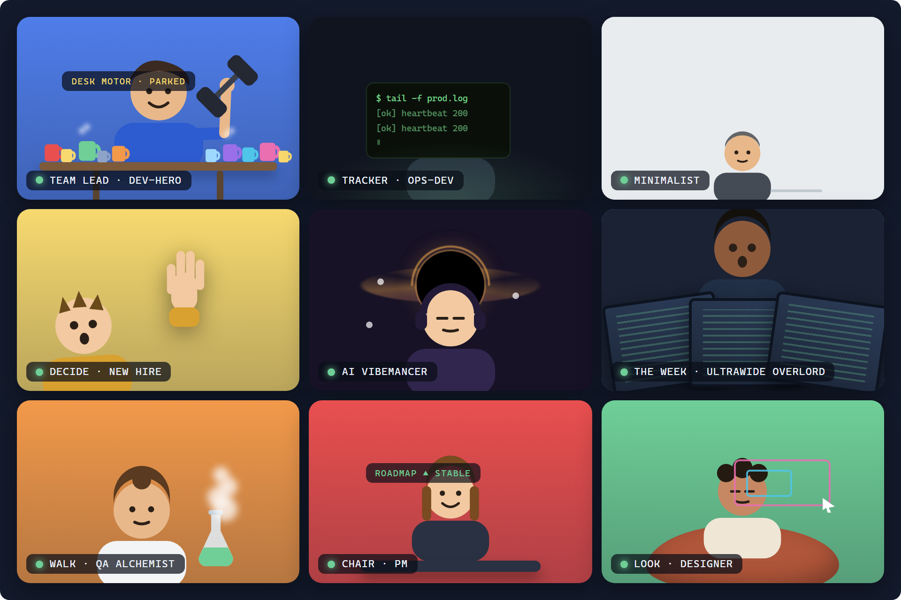

# ToolKit

```text
              ..............
           ...::::::::::::::...
     #######:::::::::::::::::###. ##   ## ###  ##
     #######:::::::::::::::::###..##  ##  ###  ##
      .###::::#####:::#####::###::## ##       #####
     ..###:::##:::##:##:::##:###::####    ###  ##
     ..###:::##:::##:##:::##:###::####    ###  ##
     ..###:::##:::##:##:::##:###::##.##   ###  ##
     ..###:::##:::##:##:::##:###::##. ##  ###  ##
     ..###:::##:::##:##:::##:###::##.  ## ###  ##
      .###::::#####:::#####::####:##   ## ###   ###
       ...::::##:::::::::##:::::...
         ..:::::##:::::##::::::..
           ...::::#####:::::...
              ..............
```


[](https://github.com/johnfrog76/toolkit/actions/workflows/verify.yml)

ToolKit is a studio where you work on software by yourself, on a team, or orchestrating agents, and
the cards are the record either way. It is local-first: prompt cards offline, items on an enterprise
board, or a crew of agents, through one front door, with nothing you think locked inside a chat log.

- **Your Space** is one piece of software and how you work on it: from local files alone, or connected
  to **GitHub Issues** or **Azure DevOps**. Switching Space rescopes every card, query and tool.
- **Your Studio** brings every Space together in one place: the boards, Daily, the design notes and
  specs, the prompts, with everything running on your own machine.

## How you work is up to you

| How you work | What ToolKit gives you |
| --- | --- |
| **By yourself** | Plain Markdown prompt cards, one per piece of work. Works offline, with no login, no network call and no tracker |
| **On a team** | The same cards, linked one to one with the items on your GitHub or Azure DevOps board, so your local context and the team's board stay in step |
| **Orchestrating agents** | The Team Agile tab -- the standup and triage over the repository's issues -- and the Studio's prompts for the way you work, so a crew of agents can take issues, open pull requests and report back while you decide |

## The card is the truth

Every card is a plain `.md` file in a folder you own. There is no database: state is derived from what
the file says. A card in `current/` is **Active**; a commit bullet or a `**Started:**` line makes it
**In Progress**; a `PR URL:` line or a `**Review:**` line makes it **Code Review**; moved to `archive/`
it is **Done** ([the card](docs/hub/cards.md)). Because the state is in the file, the work survives a
change of machine, editor, assistant, model or tracker, and a card can carry a picture (`tkCover`).

## The five verbs

| Verb | Command | What it does |
| --- | --- | --- |
| **Create** | `tkNewPrompt <id>` | Turn a work item or issue into a prompt file; `-Title` makes one with no tracker |
| **Ship** | `tkNewPR` | Open the PR and walk the card to Code Review |
| **Review** | `tkGetPRComments` | Pull review threads into the prompt file |
| **Reply** | `tkReplyPR` | Answer a thread, optionally mark it fixed |
| **Close** | `tkArchive` + `tkCloseItem` | Retire the file, and the tracker's card |

`tkStatus` shows every card and its state, and `tkMenu` shows the rest of the surface. A day with
these verbs, and triage without a prompt file, are in [The CLI, "The workflow"](docs/CLI.md#the-workflow).

## Three halves, one local engine

1. **The CLI** (PowerShell): the `tk*` verbs, every rule of state, the trackers. Nothing else has to be running. [The CLI](docs/CLI.md)
2. **The agent** (FastAPI): read routes over the same config and store, and a bridge that runs CLI verbs. [`agent/README.md`](agent/README.md)
3. **The web UI** (React): the Studio shell that mounts the board, Daily, the tracker's tabs and each module that is on. [`web/README.md`](web/README.md)

The web UI reads through the agent, and nothing in the web half changes a card except through the CLI: one implementation per write. [How the halves fit](docs/ARCHITECTURE.md).

## Off means absent

The core -- your cards, the board, the Studio, Daily -- is always there. The add-ons -- Azure DevOps,
reminders (organize), 1:1 agendas (communication), what you learned (growth), narrated decks (deck),
a quiet room (lounge) and Team Agile -- are off until configuration turns one on, and off means
absent: no verb, no route, no tab. `tkMenu -All` names every surface either way.

## Quick start

```powershell
Import-Module ./utilities.psm1 -Force                   # this shell
tkInstallAutoload                                       # every future shell
tkStart                                                 # a hub of sample cards, and the web UI open
tkNewPrompt -Title "Timeout on large files" -Type Bug   # a card of your own, no tracker needed
tkStatus                                                # every open card and its derived state
```

No login and no network: `tkStart` copies a sample hub to `~/toolkit-hub` and opens the web UI on a
Space that works from its files alone. **[Quick start](docs/QUICKSTART.md)** has the requirements, what
each line does, how to check it worked, and how to connect a real Space.

## Documentation

This file is the front door. Each subject has one document that owns it; the others link to it.

| Document | What it covers |
| --- | --- |
| **[Quick start](docs/QUICKSTART.md)** | Requirements, install, autoload on both PowerShell hosts, the first run (`tkStart`), a first card, the web UI up, and the supported platforms: macOS and Windows verified, Linux's suites green in CI |
| **[Configuration](docs/CONFIGURATION.md)** | `tkConfig`, the three files and who writes each, `consts.json`, the hub's `hub.json` and its Spaces |
| **[The CLI](docs/CLI.md)** | The prefix, the workflow and its three state machines, the command reference, tiers, errors, the log, AI review, the agentic workflows |
| **[Testing](docs/TESTING.md)** | `tkSetup`, the four runners, every suite and its count, one toolkit per shell |
| **[The agent and the web UI](docs/ARCHITECTURE.md)** | How the three halves fit, and the overview of the other two: routes, `/env`, the bridge, the shell, Docker, the repo layout |
| **[The modules](docs/modules/README.md)** | The add-ons -- Azure DevOps, growth, communication, organize, deck, lounge -- and the Studio, which is core; what each one's document must contain, "off means absent", how a module contributes commands (D-CM) |
| **[Known gaps](docs/KNOWN-GAPS.md)** | What it does not do yet, what you see if you try, and the issue that carries each |
| [`agent/README.md`](agent/README.md) | The agent in detail: layout, tier, identity, the route table, the bridge contract |
| [`web/README.md`](web/README.md) | The web UI in detail: the `ToolkitModule` interface, cards and writes, the smoke test, production |
| [`docs/modules/ado.md`](docs/modules/ado.md), [`growth.md`](docs/modules/growth.md), [`communication.md`](docs/modules/communication.md), [`organize.md`](docs/modules/organize.md), [`studio.md`](docs/modules/studio.md), [`solitaire-agile.md`](docs/modules/solitaire-agile.md), [`lounge.md`](docs/modules/lounge.md) | **Each add-on end to end (and the Studio, core), written to stand alone** -- the switch, what it owns, the verbs, routes and pages, what it writes into the hub and how its status is read, the tests, its known gaps |
| [`docs/modules/deck.md`](docs/modules/deck.md) | The deck module, briefly: turn it on, where it shows, what ships, how to add a deck. The engine's manual is Connected Deck's own README |
| [`docs/SCENARIOS.md`](docs/SCENARIOS.md) | **The scenario grid**: every configuration a machine can be in -- Space status, tier, tracker, each module on or off -- and what you see in each, with the test that holds it |
| [`docs/hub/`](docs/hub/README.md) | **The data model**: what is in a hub, and the shape of each file -- [the card](docs/hub/cards.md), [growth items](docs/hub/growth.md), [1:1 sessions](docs/hub/manager.md), [reminders](docs/hub/reminders.md) |
| [`VERIFY.md`](VERIFY.md) | The manual runbook: twelve gates from install to the Windows cold start |
| [`AGENTS.md`](AGENTS.md) | The guide for anyone, person or assistant, working in this repo |
| **[Contributing](docs/CONTRIBUTING.md)** | The contributor's first page: set up the three halves, run the suites, the refusal contract, the documentation rule, how a pull request is reviewed |
| [THIRD-PARTY-NOTICES.md](THIRD-PARTY-NOTICES.md) | Every dependency's license, and where each font, picture and sound came from |
| [SECURITY.md](SECURITY.md) | How to report a vulnerability, what is in scope, and the trust model in brief |
| [GitHub Issues](https://github.com/johnfrog76/toolkit/issues) | The backlog; how one is filed, worked and closed is in [Contributing, "Start with an issue"](docs/CONTRIBUTING.md#start-with-an-issue) |
| [`docs/ROADMAP.md`](docs/ROADMAP.md) | The order the larger design ideas get built in, and why |
